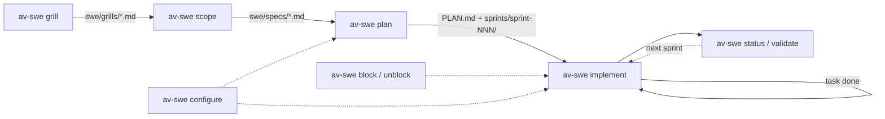
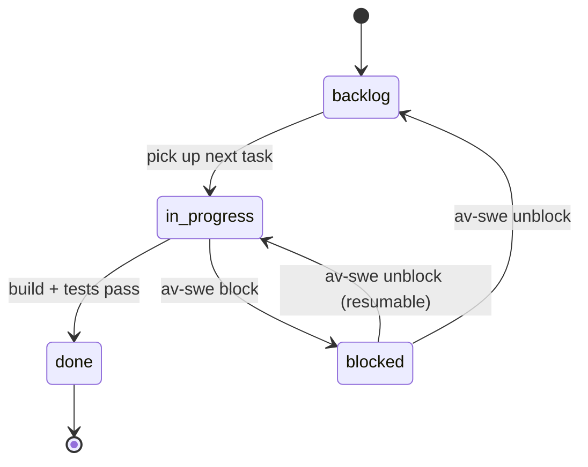
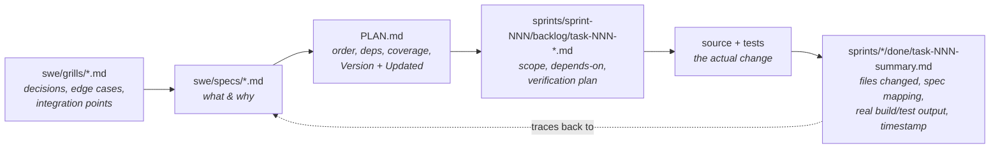

# av-swe

An [Agent Skill](https://agentskills.io) for managing a large-scale software engineering project
as a versioned, ordered, dependency-aware task plan — executed one sprint at a time through a
`backlog -> in_progress -> blocked -> done` state machine, with an auditable trail and `PLAN.md`
as the single source of truth.

The real source code is always present and in scope: specs and tasks reference it directly, and
every task is gated on your project's actual build/typecheck/lint/test commands — never a guess.



## Install

```bash
npx skills add avatsaev/av-swe-skill
```

This uses the official [`skills`](https://www.npmjs.com/package/skills) CLI (the native agent-skills
package manager, maintained by Vercel), which auto-detects your coding agent (Claude Code, Cursor,
Codex, Gemini CLI, and 70+ others) and installs the skill into its skills directory.

```bash
# Install globally, available across all projects
npx skills add avatsaev/av-swe-skill -g

# Install to a specific agent
npx skills add avatsaev/av-swe-skill -a claude-code
```

The skill is also published to the npm registry as [`av-swe`](https://www.npmjs.com/package/av-swe)
for registry-based tooling such as [`skillpm`](https://skillpm.dev):

```bash
npx skillpm install av-swe
```

## What it does

Eight operations, driven from a plan root (default `<project-root>/swe/`):

| Op | Effect |
|----|--------|
| `grill` | Interrogate a rough feature idea back-and-forth into a decided brief before scoping |
| `scope` | Capture requirements and current architecture into spec docs |
| `plan` | Derive an ordered sprint + task plan from specs/source |
| `implement` | Execute one sprint through the state machine, gated on build + test |
| `status` | Report plan health: open/in_progress/blocked/done, next sprint, gaps |
| `validate` | Check plan integrity (ordering, deps, coverage, ids) |
| `block` / `unblock` | Move a task to/from the blocked state |
| `configure` | Inspect or set project conventions |

Only `implement` writes source code — the rest produce or mutate planning artifacts.



## See it work

Each of the four ops that shape a project is drawn as a small machine whose motion *is* the op.
The animations are plain SVG (no GIF, no script), and follow your light/dark theme.

### `grill` — a card-punch press

A reader scans the code, then a sled feeds the brief card through the punches, one theme per round
(three to five questions each). Every answer is punched into the card the same round. A blocking
question stays scored, not punched, until it is resolved. Four gauge pins test the finished card
(required sections, edge cases, no blockers, your own confirmation) and only then does the barrier
lift and the card leave marked `grilled`.

<picture>
  <source media="(prefers-reduced-motion: reduce) and (prefers-color-scheme: dark)" srcset="docs/anatomy/svg/grill-dark-still.svg">
  <source media="(prefers-reduced-motion: reduce)" srcset="docs/anatomy/svg/grill-light-still.svg">
  <source media="(prefers-color-scheme: dark)" srcset="docs/anatomy/svg/grill-dark.svg">
  
</picture>

### `scope` — a copying pantograph

A stylus follows the outer walls of the real code, and a linked pen draws the same outline at half
scale onto a spec card. The specs capture each module's contract and none of its source. After each
card the pen writes one line of the `overview.md` index. Where an edge cannot be read, the pen lifts
and a `TODO(verify)` flag goes up instead of a guess.

<picture>
  <source media="(prefers-reduced-motion: reduce) and (prefers-color-scheme: dark)" srcset="docs/anatomy/svg/scope-dark-still.svg">
  <source media="(prefers-reduced-motion: reduce)" srcset="docs/anatomy/svg/scope-light-still.svg">
  <source media="(prefers-color-scheme: dark)" srcset="docs/anatomy/svg/scope-dark.svg">
  
</picture>

### `plan` — a pick-and-place gantry

A picker cuts one task tile at a time from the spec it covers and sets it into a sprint tray, foundation
first, so every task a tile depends on is already in a tray. Each placed tile writes a row of
`PLAN.md`. The plan is done when every sprint has its four state folders, every spec is covered and
no task points forward.

<picture>
  <source media="(prefers-reduced-motion: reduce) and (prefers-color-scheme: dark)" srcset="docs/anatomy/svg/plan-dark-still.svg">
  <source media="(prefers-reduced-motion: reduce)" srcset="docs/anatomy/svg/plan-light-still.svg">
  <source media="(prefers-color-scheme: dark)" srcset="docs/anatomy/svg/plan-dark.svg">
  
</picture>

### `implement` — a rotary index table

One task at a time, lowest number first: claim (its dependencies must already be done), understand,
implement, then test against the real build, lint, test and acceptance commands. A failing test turns
the table back to the spindle and the task stays `in_progress`. Only when every gate is green does the
task move to `done` with its summary. When the backlog is empty the full suite runs once more.

<picture>
  <source media="(prefers-reduced-motion: reduce) and (prefers-color-scheme: dark)" srcset="docs/anatomy/svg/implement-dark-still.svg">
  <source media="(prefers-reduced-motion: reduce)" srcset="docs/anatomy/svg/implement-light-still.svg">
  <source media="(prefers-color-scheme: dark)" srcset="docs/anatomy/svg/implement-dark.svg">
  
</picture>

<details>
<summary>How the animations are made</summary>

Each op has a script in [`docs/anatomy/`](docs/anatomy) that builds an interactive page with the `anatomy`
agent skill's isometric kit (hover to scrub, arrow keys to step, space to pause; open the `.html` locally).
`export-svg.mjs` then steps each page's own timeline in headless Chrome and writes the animated SVGs, so
the drawing, the counts and the readouts all come from one model.

```bash
node docs/anatomy/grill.mjs            # also scope.mjs, plan.mjs, implement.mjs -> <op>.html, <op>-light.html
node docs/anatomy/export-svg.mjs       # -> docs/anatomy/svg/<op>-<dark|light>[-still].svg
```

It needs a Node with a global `WebSocket` (22+; tested on 24), a Chrome or Chromium (`CHROME_PATH`) and the
`anatomy` skill (`~/.agents/skills/anatomy`, or set `ANATOMY_DIR`).

</details>

## The plan is documentation — built for agent handoff

Every artifact av-swe produces is durable, self-describing markdown on disk. That makes the plan
root a **shared memory** for agents: a fresh agent — different session, different model, zero
conversation history — can open `swe/` and reconstruct the full state of the project: what's being
built and why (`specs/`), in what order and how far along (`PLAN.md` + folder positions), and
exactly what happened on every finished task (`sprints/*/done/*-summary.md`).



Concretely, the traceability chain works in both directions:

- **Forward** — every spec section maps to at least one task (`PLAN.md` has an explicit coverage
  table), every task names what it covers and depends on, and every completed task leaves a summary
  mapping the implementation back to those spec sections.
- **Backward** — given any source change, its task summary tells a future agent *why* it exists,
  which spec drove it, and the actual commands + outputs that proved it worked.

The **timeline** is equally legible without any external tracker:

- A task's physical folder (`backlog/` → `in_progress/` → `blocked/` → `done/`) *is* its state — no
  stale status fields to trust.
- Each summary carries a completion timestamp; `PLAN.md` carries a version and last-updated date.
- Blocked tasks record *why* they're blocked, so the next agent doesn't rediscover the blocker.
- Everything is plain files, so `git log` over `swe/` gives the full development history for free.

In practice this means agents can hand off mid-project with no briefing: `av-swe status` answers
"where are we", the next backlog task answers "what do I do", and the summaries answer "what did the
agents before me do, and did it actually work".

## Usage

Once installed, the skill activates automatically when your prompt matches its description (planning
a large project, breaking work into sprints, running a sprint, checking status). You can also invoke
an op directly by name — `av-swe <op> [args]`.

### Grill a rough idea

```
> av-swe grill "let users export their order history as CSV"
```

Runs a themed back-and-forth — problem & outcome, scope boundary, happy path, data & state,
integration points, edge cases & failure modes, non-functional constraints, acceptance — one theme
per round, 3–5 questions per round, each with the agent's recommendation and concrete options. The
agent reads the real codebase first so questions and edge cases are grounded in what exists
("orders are soft-deleted via `deleted_at` — include them in the export?"), and every answer lands
in the brief the same round, so a grill can be resumed in a later session with
`av-swe grill <name>`:

```
swe/grills/
  export-order-history-csv.md     # Status: grilling → grilled
```

A `grilled` brief is primary input to `scope`; unknowns become `TODO(verify)` with an owner, never
silent defaults.

### Bootstrap a new plan

```
> av-swe scope
```

Reads the existing codebase, any grilled briefs, and your stated requirements, and writes spec docs:

```
swe/specs/
  overview.md
  features/checkout.md
  architecture/persistence.md
```

```
> av-swe plan
```

Derives an ordered sprint/task breakdown from the specs (or straight from source if `scope` was
skipped):

```
swe/
  PLAN.md
  sprints/
    sprint-001-foundation/
      backlog/task-001-scaffold-schema.md
      backlog/task-002-wire-migrations.md
      in_progress/.gitkeep
      blocked/.gitkeep
      done/.gitkeep
```

### Run a sprint

```
> av-swe implement sprints/sprint-001-foundation
```

Works one task at a time through `backlog -> in_progress -> done`, gated on the project's real
build/typecheck/lint/test commands. Never marks a task done with a failing build; a stuck task stays
in `in_progress/` with a `## Blocker` section instead of being skipped. Writes a
`sprints/<sprint>/done/task-NNN-*-summary.md` audit trail per completed task. Omit the sprint
argument to auto-pick the lowest-numbered sprint that still has backlog tasks.

### Check progress

```
> av-swe status
```

```
sprints/sprint-001-foundation: goal "stand up persistence layer"
  backlog: 3   in_progress: 1   blocked: 0   done: 4
Next sprint to run: sprints/sprint-001-foundation
in_progress: task-005-add-index-migration
```

```
> av-swe validate
```

Checks sprint/task ordering, dependency direction, id uniqueness, and spec coverage; run before
`implement` to catch a mis-planned dependency early.

### Handle a blocker

```
> av-swe block sprints/sprint-001-foundation/task-005-add-index-migration "waiting on staging DB credentials"
> av-swe unblock sprints/sprint-001-foundation/task-005-add-index-migration
```

`block` moves the task to `blocked/` and records why; `unblock` moves it back to `backlog/` (or
`in_progress/` if it can resume immediately).

### Adjust conventions

```
> av-swe configure
```

Inspects or edits `swe/av-swe.config.json` — plan root, sprints directory,
build/typecheck/lint/test commands, skipped gates, parallel-sprint execution. Every field defaults
sanely; a missing file means "use the project's standard commands."

## When to use it

Use this skill when you want to turn a rough feature idea into a decided definition before specing
it; plan a large project, feature set, migration, or refactor; break a
large body of work into sprints and small atomic tasks; execute a planned chunk of work with
confidence it actually builds and verifies; or ask "where are we", "what's next", "is the plan
consistent".

See [`skills/av-swe/SKILL.md`](skills/av-swe/SKILL.md) for the full operation index, and
`skills/av-swe/ops/*.md` / `skills/av-swe/conventions/*.md` for the full procedures.

## License

MIT
